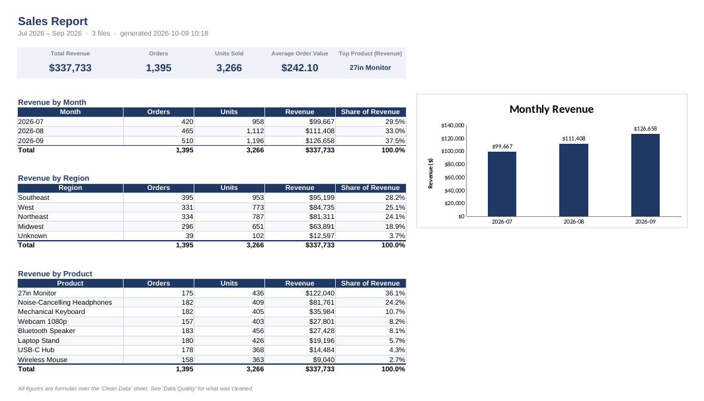

# CSV Sales Data Cleaner & Report Generator

A Python script that takes a folder of messy **monthly sales CSV exports**, cleans them into
one reliable table, and produces a **formatted Excel report** with 5 headline figures, summary
tables and a chart — in one command.

Built with **Python, pandas and openpyxl**.



## What it fixes

Real sales exports are rarely clean. The sample files in `data/raw/` contain the usual problems,
and the script handles each one:

| Problem in the raw files | What the script does |
|---|---|
| Same order exported twice, sometimes with different spacing or capitals | Removes exact duplicates after tidying text, then removes repeated order IDs (keeps the first) |
| Blank quantity or unit price | Fills with the **median for the same product** (falls back to the overall median) |
| Blank region | Fills with `Unknown` rather than guessing |
| Blank category | Looks up the product's category from other rows |
| Dates in mixed formats: `2026-07-03`, `07/04/2026`, `5-Jul-2026`, `2026/07/06` | Parses all of them into one `YYYY-MM-DD` date column |
| `" Wireless Mouse "`, `"WIRELESS MOUSE"`, `"wireless mouse"` | Trims spaces and uses the most common spelling for every variant |
| Prices like `$1,299.50` | Strips symbols and converts to numbers |
| Rows with an unreadable date or no order ID / product | Dropped and counted |

Every change is counted and written to a **Data Quality** sheet, so nothing happens silently.

## The output

Running the script writes two files to `output/`:

- **`clean_sales.csv`** – one tidy table with `order_id, order_date, month, region, product,
  category, quantity, unit_price, revenue, source_file`
- **`sales_report.xlsx`** with three sheets:
  - **Summary** – 5 headline figures (Total Revenue, Orders, Units Sold, Average Order Value,
    Top Product), revenue by month with a bar chart, and revenue by region and by product
  - **Clean Data** – every cleaned row as a filterable Excel table
  - **Data Quality** – what was removed, filled or fixed in this run

The Summary figures are **Excel formulas** (`SUM`, `SUMIFS`, `SUMPRODUCT`, `INDEX/MATCH`) that
read from the Clean Data sheet, not pasted numbers, so they stay correct if the data is edited.

## Quick start

```bash
python -m venv .venv
source .venv/bin/activate          # Windows: .venv\Scripts\activate
pip install -r requirements.txt

python -m sales_cleaner            # reads data/raw/*.csv, writes to output/
```

```
Read 1,476 rows from 3 file(s)
  removed 81 duplicates, filled 116 missing values, fixed 1,125 dates, dropped 0 unusable rows
Wrote 1,395 clean rows -> output/clean_sales.csv
Report -> output/sales_report.xlsx
Done in 0.46s
```

Use your own files:

```bash
python -m sales_cleaner --input path/to/exports --output reports --pattern "sales_*.csv"
```

Input CSVs need these columns (any order, extra columns are ignored):
`order_id, order_date, region, product, category, quantity, unit_price`.

To regenerate the sample data: `python scripts/make_sample_data.py`.

## Project structure

```
sales-data-cleaner/
├── sales_cleaner/
│   ├── cleaner.py      # loading + each cleaning step, with a CleaningLog
│   ├── report.py       # builds the formatted Excel workbook and chart
│   └── __main__.py     # command-line entry point
├── scripts/make_sample_data.py   # generates the messy sample CSVs
├── data/raw/           # 3 sample monthly files (Jul–Sep 2026)
├── tests/test_cleaner.py
└── docs/report_preview.png
```

## Testing

```bash
python -m pytest -v                # or: python -m unittest discover tests
```

Tests cover each cleaning rule (mixed dates, exact and near duplicates, median fills,
dropped rows, price symbols) and an end-to-end run that checks the CSV and the workbook's
sheets, headline formulas and chart.

## Design notes

- **Dates:** slash dates with the year last are read as US `MM/DD/YYYY`. The accepted
  formats live in `DATE_FORMATS` in `cleaner.py` if your exports use something else.
- **Duplicates are judged on the cleaned values,** not the raw text, so `" usb-c hub "` and
  `"USB-C Hub"` count as the same order.
- **Filling with the product median** keeps a missing price realistic (a monitor is not filled
  with a mouse's price) and is not pulled around by a few large orders the way a mean would be.

## Possible next steps

- Schedule it to run on the first of every month
- Email the report automatically
- Flag outliers (e.g. quantity 50× the product's usual)
- Add year-over-year comparison once a year of data is available
